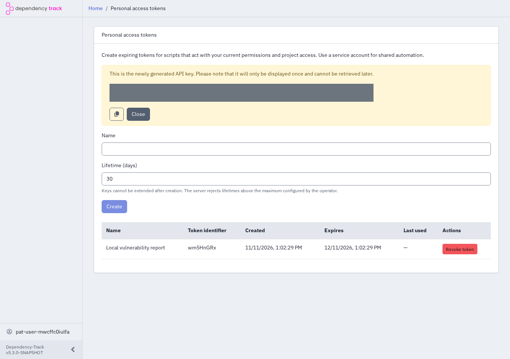
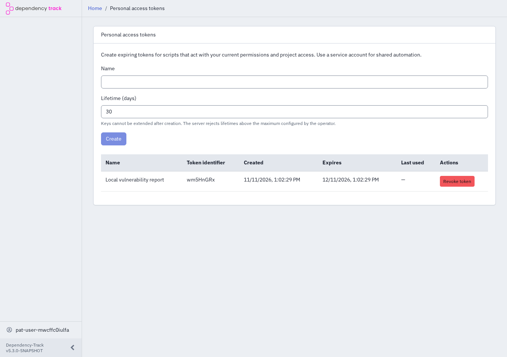
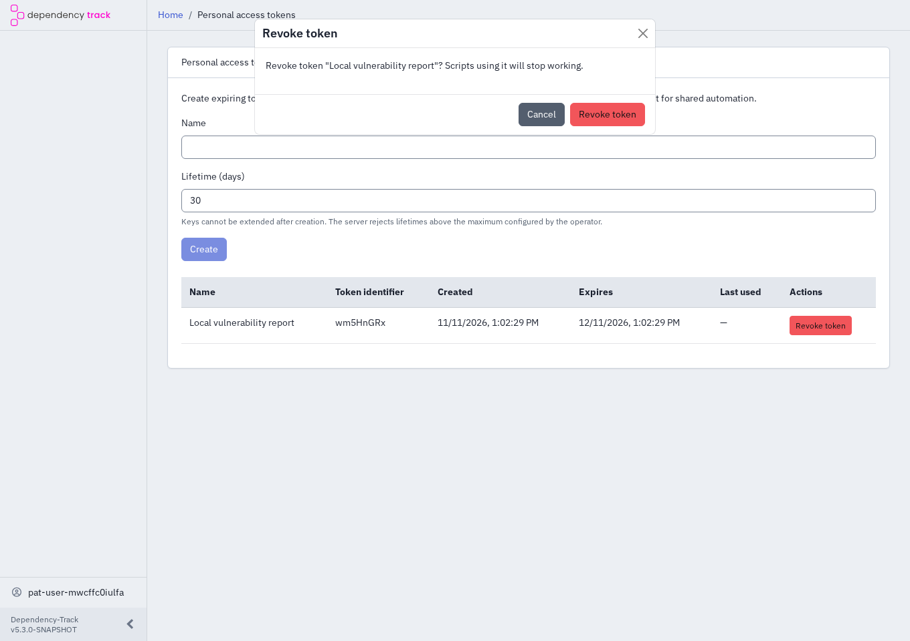
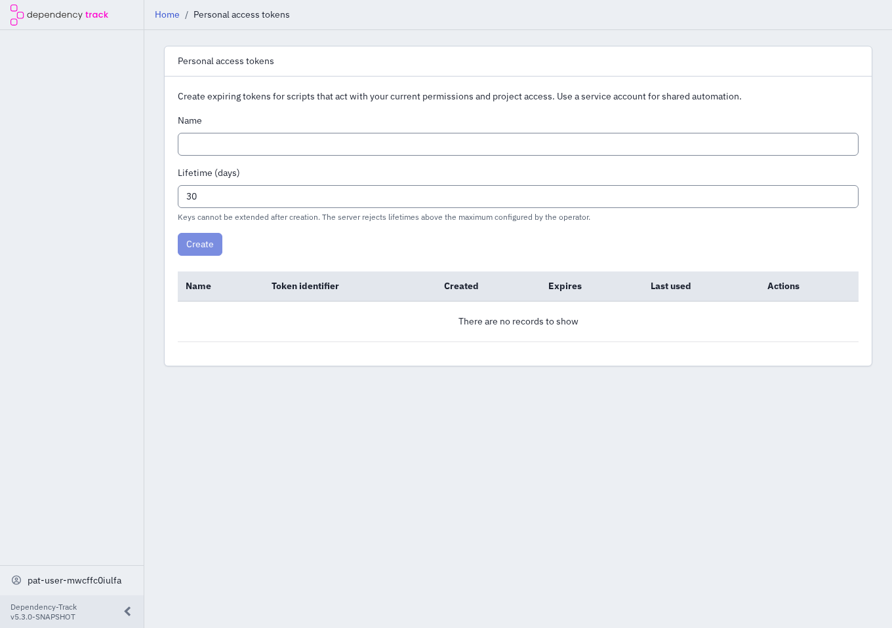

# Manage personal access tokens

!!! warning "Unreleased"

    This feature requires matching API server and frontend versions that include personal access tokens. It isn't available in Dependency-Track 5.2.1.

Use a personal access token to authenticate a script as yourself. For shared or unattended automation, use a [service account](../../concepts/access-control.md#service-accounts) instead.

## Create a token

1. Sign in to the frontend with your managed, LDAP, or OIDC account.
2. Open the profile menu and select **Personal access tokens**. You don't need an access-management permission to manage your own tokens.
3. Enter a descriptive **Name**, such as `Local vulnerability report`.
4. Set **Lifetime (days)**. The form starts at 30 days. Choose a shorter period if your administrator has configured a lower limit.
5. Select **Create**.
6. Copy the token into your password manager or the secret store used by your script, then close the token display.

!!! warning "Copy the token before leaving"

    The full token appears only after creation. Closing the display, reloading the page, or navigating away removes it. If you lose it, revoke the token and create another one. Don't include tokens in source code, screenshots, logs, or support requests.

The screenshots use an isolated test account and hide the token secret.

## Use a token

Configure your script's Dependency-Track API key setting with the full token, not its public identifier. For REST requests, send the token in the `X-Api-Key` header over HTTPS. Don't use it as a browser login password or an `Authorization: Bearer` session token.

Your token uses your current permissions and portfolio access in Dependency-Track. It doesn't add permissions or bypass project access restrictions. See [Personal access tokens](../../concepts/access-control.md#personal-access-tokens) for authorization and account lifecycle limits.

For an API upload example, see [Upload a BOM](uploading-boms.md#upload-via-rest-api).

## Review your tokens

Open **Personal access tokens** to review names, public identifiers, creation dates, expiry dates, and last-used timestamps. Select **Load more tokens** to view more entries when available. Existing token secrets never appear in this list.

Treat the last-used timestamp as a hint, not proof that nobody has used a token. Updates can arrive late or never arrive under load.

## Revoke a token

1. Open **Personal access tokens** and find the token by name or public identifier.
2. Select **Revoke token** for that token.
3. Confirm the revocation in the dialog, or select **Cancel** to keep the token.

Requests using a revoked token fail authentication. Update any scripts that used it before their next run.

If a token might have leaked, revoke it immediately. If you can't sign in to revoke it, contact your administrator to block its access.

## Replace an expiring token

1. Create a replacement token and copy it to the script's secret store.
2. Verify that the script works with the replacement.
3. Revoke the previous token.

Sign in to the frontend to manage tokens. A personal access token can't create, list, or revoke personal access tokens, or use self-service password changes. Administrative permissions still apply to tokens, including access to administrative account-management operations.
